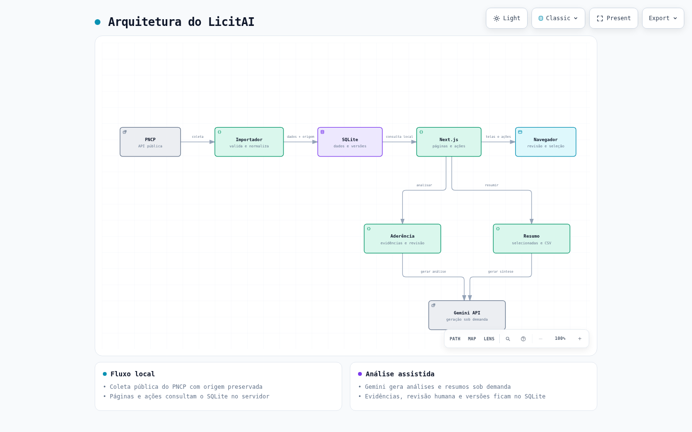

# LicitAI

**Encontre oportunidades. Acelere sua análise.**

Ferramenta local, em português brasileiro, para pesquisar um recorte de compras públicas do PNCP, conferir a origem e organizar uma seleção comercial. O foco inicial é equipamento de informática em São Paulo. O recorte, a UF e a modalidade são configuráveis.

O fluxo atual inclui importação rastreável, perfil versionado, pesquisa, seleção e anotações persistentes. A análise de aderência valida citações da descrição, registra revisões humanas e pode usar Gemini ou OpenAI. As oportunidades selecionadas também podem receber um resumo gerado com Gemini e exportado em CSV.

O produto auxilia a triagem comercial. Não determina habilitação jurídica, não garante elegibilidade e não envia propostas.

## Arquitetura

[](docs/licitai-architecture.html)

[Baixe o diagrama interativo](docs/licitai-architecture.html) e abra o HTML localmente no navegador para explorar os componentes, conexões e modos claro/escuro.

O importador consulta a API pública do PNCP, valida e normaliza os registros e grava os dados e sua origem em SQLite. As páginas e ações do Next.js consultam essa base no servidor; o navegador apresenta oportunidades, análises, revisões e seleções. A análise de aderência e o resumo das selecionadas são executados sob demanda. O Gemini gera ambos; a análise individual pode usar OpenAI quando Gemini não estiver configurado. Evidências, decisões humanas e resumos versionados ficam no SQLite. O resumo pode ser exportado em CSV.

| Parte | Código principal |
| --- | --- |
| Importação PNCP | `src/lib/pncp` |
| Páginas e ações | `src/app` |
| Persistência local | `src/lib/db.ts` |
| Aderência, evidências e revisão | `src/lib/adherence` |
| Resumo e exportação | `src/lib/summary.ts`, `src/app/api/selecionadas/resumo` |
| Integração Gemini | `src/lib/server/gemini.ts` |

## Instalação e execução

Requer Node.js **22.13+ na linha 22, ou 24+**, com `node:sqlite` disponível, e npm. A versão utilizada está em `.nvmrc`. No Node 22, SQLite pode emitir um aviso de recurso experimental.

```bash
nvm use
npm ci
cp .env.example .env
npm run demo
npm run dev
```

Acesse [http://127.0.0.1:3000](http://127.0.0.1:3000). O comando `demo` carrega **50 registros públicos reais como amostra histórica**, sem precisar de acesso ao PNCP. A tela “Coletas e origem” oferece a mesma ação. Também é possível iniciar com a base vazia e importar pela interface.

O banco é criado automaticamente em `data/licitai.sqlite`. Perfil, seleções e anotações permanecem após reiniciar. O banco e seus arquivos auxiliares não são versionados. A amostra JSON pode ser versionada porque contém dados públicos de demonstração; não inclua dados privados nela.

Para executar a versão de produção local:

```bash
npm run build
npm start
```

Os servidores escutam somente em `127.0.0.1`. Esta fase não inclui publicação nem autenticação.

## Importar do PNCP

```bash
# Padrão: últimos 3 dias de publicação em Brasília, SP, pregão eletrônico,
# até 2 páginas de 50 e 100 registros processados.
npm run import:pncp

# Recorte explícito e preservação de uma amostra da primeira página.
npm run import:pncp -- --from 2026-11-10 --to 2026-11-12 --uf SP --modality 6 --page-size 50 --max-pages 2 --max-records 100 --save-sample data/minha-amostra.json

npm run import:pncp -- --help
```

Datas representam **publicação**, não recebimento de propostas. A API exige uma modalidade por consulta; `6` é pregão eletrônico e `8` é dispensa. Esta versão da interface oferece essas duas modalidades. Limites de proteção do importador: 31 dias, 20 páginas e 1.000 registros processados por execução. O tamanho de página aceito é **10 a 50**, conforme o Swagger atual consultado, apesar de o manual antigo citar 500.

`--max-records` limita os registros persistidos. A última página pode trazer mais registros do que o limite restante; o histórico distingue “lidos” de “processados”. A coleta informa quando restam páginas. A base é um recorte, sem promessa de cobertura total do PNCP.

Timeout padrão de 15 segundos por tentativa e até duas novas tentativas para falhas de rede, HTTP 408, 429 e 5xx. Erros 4xx comuns e respostas incompatíveis com o esquema não são repetidos. Páginas anteriores permanecem gravadas se uma página seguinte falhar; o histórico registra a execução como parcial. O comando sai com código 1 se a importação falhar ou ficar parcial por erro.

Configurações opcionais estão em [.env.example](.env.example). As opções da linha de comando prevalecem sobre o ambiente.

## Importar arquivo / trabalhar offline

```bash
npm run import:file -- data/pncp-sample.json
npm run demo
```

O formato está exemplificado em [data/pncp-sample.json](data/pncp-sample.json) e validado por `archiveSchema` em `src/lib/pncp/schema.ts`: `schemaVersion`, `dataKind`, `collectedAt` com offset, `sourceUrl` HTTPS da API PNCP, `description` e `records`. Aceita no máximo 5.000 registros por arquivo. Os registros usam o mesmo esquema conferido na API.

Arquivos importados são apresentados como **amostra histórica**, mesmo se sua coleta for recente. Dados sintéticos exigem `dataKind: "synthetic"` e recebem identificação própria na interface. O marcador de origem do arquivo é uma declaração de quem o preparou; não constitui certificação de autenticidade. Uma amostra antiga nunca substitui uma observação mais recente do mesmo ID.

## Usar a aplicação

1. **Perfil da empresa:** revise nome, descrição, termos e UF. Cada salvamento gera uma versão persistente. A UF define o filtro inicial; termos de interesse e exclusão ficam registrados, sem descartar oportunidades automaticamente.
2. **Oportunidades:** pesquise por descrição, órgão, cidade ou ID. Combine UF, data de publicação e valor. O foco inicial em informática procura palavras no objeto; “Toda a base” desativa esse foco. Valores ausentes não atendem filtros numéricos.
3. **Detalhes:** confira descrição original, prazos, valores, situação e fonte oficial. Campos ausentes aparecem como “Não informado”. Há acesso ao JSON original coletado e à consulta utilizada.
4. **Selecionadas:** salve oportunidades, registre e salve anotações ou remova da seleção. Todas as alterações são persistidas no SQLite.

Busca textual, valores e foco de informática são filtros **locais sobre os dados importados**. Eles não classificam aderência. Uma coleta ao vivo com mais de sete dias passa a ser identificada como histórica. “Coleta recente” descreve somente a idade da coleta; não afirma que a contratação continua recebendo propostas. A situação exibida é a informada pela fonte.

## Testar

```bash
npm run typecheck
npm run lint
npm test
npm run build
# Ou todos os quatro:
npm run check

# Com a aplicação já em execução e a amostra carregada:
npm run smoke
# Porta alternativa:
npm run smoke -- --url http://127.0.0.1:3001
```

Os testes usam uma resposta real preservada e variações **sintéticas restritas aos testes**. Cobrem normalização, campos ausentes, datas, idempotência, histórico, filtros, SQL parametrizado, paginação, persistência ao reabrir o banco, arquivos inválidos, falhas de comunicação, timeout e limite de tentativas. Não dependem da rede pública.

O executor de testes utiliza `--experimental-test-isolation=none` para funcionar em ambientes que restringem subprocessos; cada teste de banco usa uma instância isolada. O build usa a opção oficial `--webpack` para evitar a porta interna de compilação do Turbopack em ambientes restritos. O desenvolvimento usa o padrão do Next.js. A dependência transitiva `minimatch` de `@typescript-eslint/typescript-estree` foi fixada na linha corrigida 11.0.1+; o lockfile registra a resolução. O ESLint 9 é mantido por compatibilidade declarada pelos plugins atuais do Next.js.

O smoke test verifica HTTP, conteúdo renderizado no servidor, CSS e o endpoint do registro original. Ele **não substitui testes de interação nem revisão visual em navegador**.

## Análise de aderência — etapa 3

Configure `GEMINI_API_KEY` ou os campos OpenAI de [.env.example](.env.example), mantendo a chave somente no servidor. Quando há chave Gemini, a análise individual usa Gemini; caso contrário, usa OpenAI, se configurada. Em detalhes, “Analisar aderência” compara a oportunidade com o perfil persistido. A execução é explícita; abrir páginas não chama o modelo. O resumo das selecionadas exige Gemini.

O resultado gerado passa por validação de evidências literais da descrição. A interface permite registrar concordância ou discordância humana, sem transformar a análise em decisão jurídica. Falhas não são reutilizadas como resultados. As migrações do banco são automáticas e aditivas.

```bash
npm run eval:adherence          # apresenta os cinco casos reais, sem chamada externa
npm run eval:adherence -- --run # exige chave; até cinco gerações, com retries configurados
```

Veja o [handoff de integração](docs/handoffs/adherence-analysis.md) e o [relatório desta frente](docs/handoffs/adherence-validation.md) para contratos, configuração e testes da análise individual.

## Dados reais validados nesta entrega

Em **12/11/2026**, foram realizadas consultas HTTP 200 ao endpoint oficial de publicações e ao endpoint de detalhe. O importador gravou **200 oportunidades reais distintas**, em dois recortes pequenos de SP/pregão eletrônico. A amostra versionada preserva 50 registros da primeira página do recorte de 12/11, com fonte e instante da coleta. Os 200 registros estão no banco local desta execução; uma instalação nova começa com 50 ao executar `npm run demo`.

Consulte [docs/pncp.md](docs/pncp.md) para os parâmetros, campos, evidências e limitações da validação. As decisões das etapas iniciais estão em [docs/architecture.md](docs/architecture.md), os checks executados em [docs/validation.md](docs/validation.md) e os próximos passos em [docs/next-steps.md](docs/next-steps.md).
